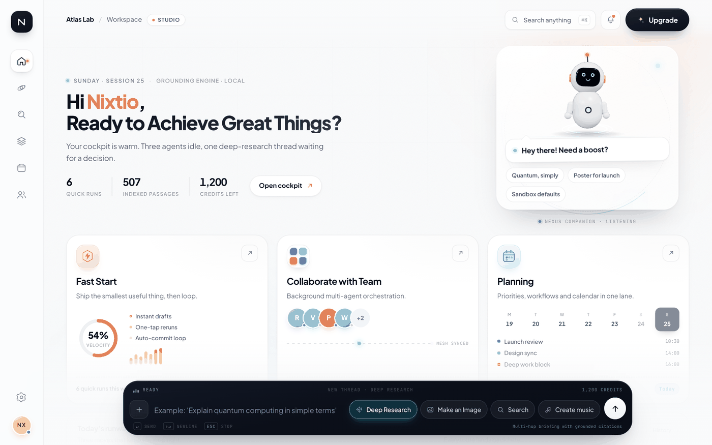
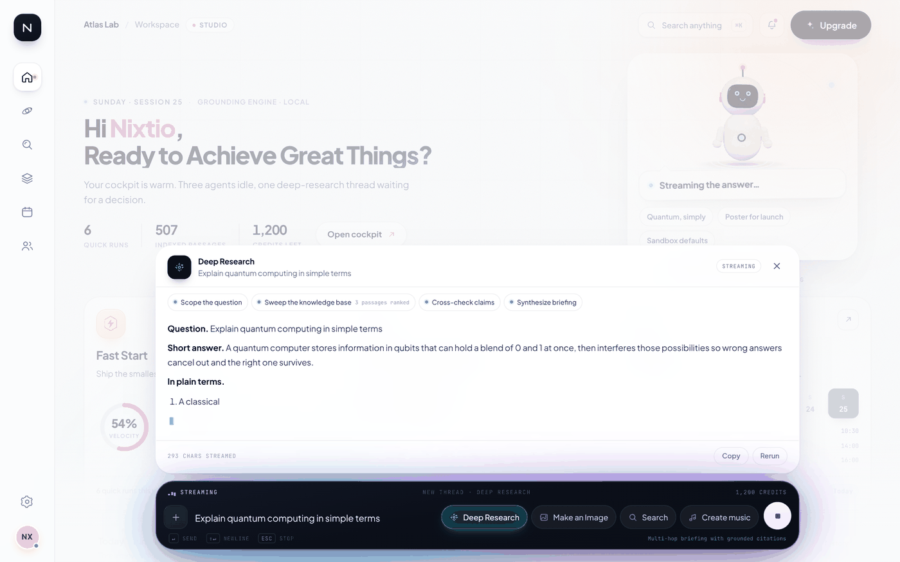

# NEXUS OS — Workspace & Multi-Modal Cockpit

The premium light-mode workspace (`frontend/workspace.html`) is the product-facing
front door to NEXUS: a calm off-white canvas for the work *around* the model, plus a
dark floating console that is the control surface for four backend routes.

- **Page:** `/workspace` (alias `/workspace.html`)
- **API:** `/api/workspace/*` — `backend/routers/workspace.py`
- **Tests:** `tests/unit/test_workspace_cockpit.py` (42 cases, no LLM required)



```
Screen 1  dashboard   hero + companion bubble, Fast Start / Collaborate / Planning,
                      today's runway, recent threads, searchable Platform Spaces
Screen 2  cockpit     graphite pill: textarea + Deep Research · Make an Image ·
                      Search · Create music, dual-layer cyan/violet aura,
                      streaming result surface
```

## Why it is built this way

The page is a **buildless MPA** in `frontend/`, like `index.html` and `holo.html`, so
`python backend/main.py` serves it with no Node toolchain. It is registered in
`frontend/vite.config.mjs` for anyone who wants HMR, but production does not need it.

Fonts (Plus Jakarta Sans, JetBrains Mono) are vendored under
`frontend/workspace/fonts/` with their OFL licences, so the cockpit renders
identically offline — no font CDN, no layout shift.

The robot companion is **procedurally rendered with the repo's vendored three.js**
(`frontend/vendor/three.module.js`). No GLB download, no CDN: it is ~35 draw calls,
pauses when off-screen or when the tab is hidden, and falls back to an inline SVG
robot when WebGL is unavailable.

## Screen 1 — dashboard

| Region | Behaviour |
|---|---|
| Left rail | 88px glass rail, line-art icons, tooltips, active-state dot |
| Header | workspace crumb, plan pill, quick-find (`⌘K`), notifications (the dark **Upgrade** pill was removed per product decision — no upsell surface) |
| Hero | `Hi Nixtio, Ready to Achieve Great Things?`, live engine label, session meta |
| Companion | 3D robot in a translucent bubble: “Hey there! Need a boost?” + three prompts |
| Fast Start | orange geometric tile, velocity ring, sparkline, weekly metric |
| Collaborate with Team | multi-colour grid tile, agent faces, animated mesh bus |
| Planning | blue calendar tile, live week strip (real dates), agenda |
| Lower row | Today's runway (resume a thread) + recent threads |
| Platform Spaces | searchable ten-space catalog with priority filter, evidence paths, runtime notes, and refresh |

Everything numeric comes from `GET /api/workspace/bootstrap`: identity, engine state,
usage meters, knowledge-index size, feature cards, route catalog, Spaces summary,
activity and history. The week strip is computed client-side from the real date.
`GET /api/workspace/spaces?q=&priority=` returns the **same**
`nexus.domain.value_objects.upgrade_spaces` catalog used by the React app, core API,
and static dashboard; the legacy controller renders it with text nodes rather than
interpolating API fields into HTML.

## Screen 2 — the cockpit

Four chips map to backend routes (the chip is the route selector; `↵` sends):

| Chip | Route | Server work |
|---|---|---|
| **Deep Research** | `deep_research` | retrieval + grounding (or live LLM), cited briefing |
| **Make an Image** | `image` | deterministic 1200×860 SVG poster + art direction |
| **Search** | `search` | BM25-lite ranking over `docs/`, `README.md`, sample notes |
| **Create music** | `music` | mood → key/BPM blueprint + synthesized 8s WAV |



### Streaming contract (SSE)

`GET /api/workspace/runs/{id}/stream` emits `event:`/`data:` frames. The UI maps
`state` onto `data-state` on `<html class="nx-app">`, which is what drives the aura:

```
state {status: thinking,  label: THINKING}      → cyan layer dominant
plan  {steps: [...]}                            → step chips appear
step  {id, status: running|done, note}          → chips tick over
state {status: streaming, label: STREAMING}     → violet layer takes over
delta {text}                                    → typed answer (markdown)
artifact {...}                                  → poster / audio / source cards
usage {...}                                     → credit meter decrements live
meta  {engine, latency_ms, citations, note}
done  {run}                                     → READY
```

Cancelling (`Esc` or the stop button) POSTs `/cancel`; the stream ends with
`state: cancelled` then `done`. The initial run-creation request and SSE reader use
the same browser `AbortController`, the prompt draft is restored from session storage,
Enter is ignored during IME composition, and streamed output only sticks to the bottom
while the reader is already there — otherwise **Jump to latest** appears. Re-opening a
finished run's stream **replays** the recorded frames, so a reconnect never loses the
answer.

### Honesty rules for offline operation

No LLM is required to demo the cockpit, but nothing is dressed up as model output:

| `meta.engine` | Meaning | Badge |
|---|---|---|
| `llm` | a live model answered (passages in the prompt) | green |
| `local-grounding` | composed from retrieved repository passages, with source paths | cyan |
| `local-primer` | corpus is silent; a built-in plain-language primer is returned | amber |
| `local-renderer` / `local-synth` / `local-index` | procedural work, no model | route-coloured |

Retrieval only counts as **evidence** when a passage covers ≥60% of the query terms
(`coverage` in the ranking). Weak matches are shown as “nearby but not evidence”, or
the answer states plainly that the corpus does not cover the question.

Set `NEXUS_WORKSPACE_ENGINE=llm` with a reachable model (see `config/nexus.yaml`,
`.env`) to have Deep Research stream from it; `=local` skips the probe entirely.

## Cross-surface legacy contract

The buildless pages share the same safety and interaction rules:

- `frontend/shared/voice.js` is the single voice source: recognition and speech prefer
  **Indian English (`en-IN`)**, with other English voices only as fallbacks.
- Brain Chat and both galaxy docks expose Stop through `AbortController`, preserve a
  session draft, ignore Enter during IME composition, respect manual scroll-up, and link
  back to Workspace/Spaces.
- Dynamic graph, model, dream, event, tool, and swarm labels are escaped or rendered as
  text nodes. Chat answers are never inserted as raw HTML.
- The core static dashboard keeps its API key in session storage only and includes a
  searchable Upgrade Spaces card backed by `/api/system/upgrade-spaces`.
- Stopping a non-streaming legacy chat request cancels the browser wait; it does not
  claim that a backend task already accepted by the server was rolled back.

## API reference

| Method | Path | Purpose |
|---|---|---|
| GET | `/api/workspace/bootstrap` | Screen 1 payload (identity, usage, features, routes, Spaces summary, history) |
| GET | `/api/workspace/spaces?q=&priority=` | shared ten-space catalog with server-side search/filter |
| POST | `/api/workspace/runs` | open a run → `{run, stream, plan}` (201) |
| GET | `/api/workspace/runs` | recent runs, newest first |
| GET | `/api/workspace/runs/{id}` | run snapshot (poll fallback) |
| POST | `/api/workspace/runs/{id}/cancel` | cooperative cancel |
| GET | `/api/workspace/runs/{id}/stream` | SSE frames (replay-safe) |
| GET | `/api/workspace/art/{id}.svg` | procedural poster (immutable cache) |
| GET | `/api/workspace/audio/{id}.wav` | synthesized stem (8s, mono, 22.05 kHz) |
| GET | `/api/workspace/plans` | plan catalog |
| POST | `/api/workspace/upgrade` | records intent; `checkout: not_configured` |
| GET | `/api/workspace/preview-state?state=` | aura descriptor for design hand-off |

Errors: `400` empty/oversized prompt, unknown route, or unknown Spaces priority,
`402` credit ceiling, `404` unknown run. State is per-process and bounded (`MAX_RUNS = 40`) — this is a
cockpit surface, not a durable job queue.

## Design tokens

```css
--canvas #F9FAFB   --surface #FFFFFF   --ink #0B0F19
--orange #FF7A18   --cyan #22D3EE      --violet #8B5CF6   --blue #3B82F6
radius   30/24/18px   font Plus Jakarta Sans   mono JetBrains Mono
console  linear-gradient(168deg, #121826, #0B0F19) + 30px blur shadow
```

The console is `#0B0F19` graphite; THINKING glows cyan, STREAMING glows violet, and
both layers pulse from a `data-state` attribute rather than JS animation loops.
`prefers-reduced-motion` freezes all of it (the aura stays visible, static).

## Responsive behaviour

| Width | Layout |
|---|---|
| ≥1300px | full hero (two columns), three cards, one-row console |
| 1000–1299px | condensed console, cards tighten via `vh`-aware sizing |
| 861–999px | hero stacks (copy first, companion second), cards stay 3-up |
| ≤860px | single-column cards, console switches to a two-row grid (input, then chips + send) |
| ≤640px | compact rail, condensed header, shorter companion stage |

The docking console is `position: fixed`; the stage reserves bottom padding equal to
its height so nothing is unreachable. On short viewports (768px tall) the card
metrics sit under the dock by design — the fade keeps the text legible and the page
scrolls to reveal the lower panels.

## Accessibility

Icon-only controls carry `aria-label`; chips are `aria-pressed` toggles inside a
`role="group"`; the run surface is `aria-live="polite"`; focus rings are visible
(`:focus-visible`); the waveform slider is keyboard reachable; every animation is
guarded by `prefers-reduced-motion`.

## Local run

```bash
python backend/main.py            # → http://127.0.0.1:8099/workspace
# or
python -m uvicorn backend.main:app --host 0.0.0.0 --port 8099
NEXUS_WORKSPACE_PACE=2 python -m uvicorn ...   # slow the stream down for demos
NEXUS_ROOT_PAGE=workspace python -m uvicorn ...  # bare host serves the cockpit
```

```bash
pytest tests/unit/test_workspace_cockpit.py -q
ruff check backend/ && ruff format --check backend/routers/workspace.py
```
